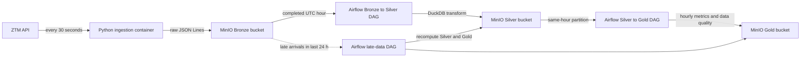

# 🚋 Warsaw Transit Data Platform

A data engineering project that continuously collects **real-time GPS positions
of Warsaw public transport vehicles reported by the feed** (ZTM buses and trams) from the
[UM Warszawa Open Data API](https://api.um.warszawa.pl) and stores them in an
S3-compatible data lake. The implemented pipeline follows a **medallion
architecture**: raw JSON Lines in bronze and cleaned, hourly Parquet in silver;
hourly business and data-quality metrics in gold.

> 🚧 Work in progress – ingestion, hourly Bronze → Silver and Silver → Gold
> pipelines, late-data recomputation, tests, and GitHub Actions CI are implemented.
> A dashboard and production cloud deployment remain future work; see the
> [roadmap](#roadmap).

## Architecture



Locally the data lake runs on **MinIO**, which provides an S3-compatible API.
The pipeline has not yet been deployed or validated end to end on AWS S3.

## Tech stack

| Area | Technology |
|---|---|
| Runtime | Python 3.12 in ingestion/CI; Python 3.13 in the Airflow image |
| Data source | UM Warszawa REST API |
| Object storage | MinIO (S3-compatible), boto3 |
| Orchestration | Apache Airflow 3.2.1 |
| Transformation | DuckDB 1.2.2 |
| Containerization | Docker, Docker Compose |
| Data formats | JSON Lines (bronze), Parquet (silver), Hive-style partitioning |
| Testing and linting | unittest, Ruff |
| CI | GitHub Actions |

## How to run

### Prerequisites

- [Docker Desktop](https://www.docker.com/products/docker-desktop/)
- A free API key from [api.um.warszawa.pl](https://api.um.warszawa.pl) (register an account)

### Steps

1. Clone the repository:
   ```bash
   git clone https://github.com/mati290/ZTM_data_proccesing.git
   cd ZTM_data_proccesing
   ```

2. Create your `.env` file from the template and fill in the values:
   ```bash
   cp .env.example .env
   ```
   Keep your real API key and MinIO credentials in `.env`; never commit that file.
   Fill in `AIRFLOW__CORE__FERNET_KEY` as well. Generate it with Python in an
   environment containing `cryptography`, using the command in `.env.example`.
   Keep `POLL_INTERVAL_SECONDS=30` for the documented slot calculations.

   If reusing an existing Airflow metadata volume, pause the three project DAGs
   before restarting the stack. The paused-at-creation setting below applies
   only to DAGs Airflow discovers for the first time.

3. Build and start the local stack:
   ```bash
   docker compose up -d --build
   ```

   Compose starts MinIO, the ingestion container, and Airflow. Ingestion creates
   the `bronze`, `silver`, and `gold` buckets if they do not exist. Newly
   discovered Airflow DAGs are paused by default so they cannot run before the
   required pool is configured.

4. Create the Airflow pool that serializes writes to Silver and Gold:
   ```bash
   docker compose exec airflow airflow pools set ztm_silver_gold_writer 1 "Serializes Silver and Gold writes"
   ```

5. Open the Airflow UI at http://localhost:8080 and unpause the
   `bronze_to_silver_hourly`, `silver_to_gold_hourly`, and
   `reprocess_late_data_hourly` DAGs. The first two share an hourly schedule:
   Bronze → Silver processes a completed UTC hour, then Silver → Gold waits
   for that hour's Silver task and builds the four Gold tables. The late-data
   DAG runs hourly at minute 30 and recomputes eligible closed hours from the
   last 24 hours. Gold fails on a schema mismatch or missing Silver; task
   retries and published row counts/status are visible in Airflow.

   An hour with no Bronze data *after* ingestion has started (an outage)
   **fails** the Silver run after retries so the gap remains visible; once
   Bronze data is available again, clear the failed run in the UI to reprocess
   it. Hours before the first Bronze object are skipped. Hourly catchup is
   disabled, so the DAGs do not automatically create runs for every missed
   interval since their `start_date`; existing historical runs are not deleted.
   MinIO's console is at http://localhost:9001.

6. Check ingestion logs:
   ```bash
   docker compose logs -f ingestion
   ```

To stop the services, run `docker compose down`. Bronze, Silver, and Gold
objects are kept in the `minio_data` Docker volume; Airflow metadata is kept
in `airflow_metadata`. Do not add `-v` if you want to retain these volumes.
This standalone Airflow configuration, including its admin authentication
settings, is intended for local development.

## Data layout and publication

Bronze contains raw JSON Lines and one manifest for each cycle that reaches
the manifest-write step:

```text
s3://bronze/vehicle_type=bus/date=YYYY-MM-DD/hour=HH/positions_<timestamp>_<uuid>.jsonl
s3://bronze/vehicle_type=tram/date=YYYY-MM-DD/hour=HH/positions_<timestamp>_<uuid>.jsonl
s3://bronze/_manifests/date=YYYY-MM-DD/hour=HH/cycle_<timestamp>_<uuid>.json
```

Each record preserves the API fields and adds `_ingested_at`, the actual
write timestamp in UTC. New data files and the cycle manifest share the
partition of the **UTC cycle slot**, even when collection crosses an hour
or midnight. This is an ingestion-cycle partition, not a GPS event-time
partition. Historical objects retain their original write-time partitions.

```json
{"Lines": "180", "Lon": 21.01, "VehicleNumber": "1234", "Time": "2026-10-02 10:32:01", "Lat": 52.23, "Brigade": "3", "_ingested_at": "2026-10-02T08:32:05+00:00"}
```

Silver prepares a new version before replacing its active manifest:

```text
s3://silver/vehicle_positions/date=YYYY-MM-DD/hour=HH/_active.json
s3://silver/_versions/date=YYYY-MM-DD/hour=HH/<publication_id>/data.parquet
s3://silver/_versions/date=YYYY-MM-DD/hour=HH/<publication_id>/quarantine.parquet
s3://silver/_versions/date=YYYY-MM-DD/hour=HH/<publication_id>/_completeness.json
```

Read `artifacts.data`, `artifacts.quarantine` and `artifacts.completeness`
from `_active.json`. The manifest also records `source_inputs`: keys, ETags,
sizes and modification times of the selected Bronze data and cycle manifests.
If `_active.json` is absent, readers support the legacy fixed Silver paths.

Gold publishes four tables:

| Table | Grain |
|---|---|
| `vehicle_activity_hourly` | UTC partition hour, vehicle type, vehicle number |
| `hourly_line_metrics` | UTC partition hour, vehicle type, line |
| `hourly_network_metrics` | UTC partition hour |
| `hourly_data_quality` | UTC partition hour |

```text
s3://gold/_commits/date=YYYY-MM-DD/hour=HH/manifest.json
s3://gold/_versions/date=YYYY-MM-DD/hour=HH/<publication_id>/<table>/data.parquet
s3://gold/_diagnostics/date=YYYY-MM-DD/hour=HH/manifest.json
```

The full commit manifest contains the source Silver URI, finality flag,
and each table's URI and row count. Read the manifest once and use its
listed files together. The commit manifest is the publication boundary;
the quality row alone is not a commit signal. A failure before the commit
preserves the previous manifest. Missing or empty Silver produces a separate
quality diagnostic and a failed task, without replacing the full Gold commit.
Both layers use `_staging/` for temporary outputs.

See the [Gold data contract](docs/gold-data-contract.md) for column definitions
and consumer rules.

## Quality and completeness

- Silver validates coordinates against the configured Warsaw bounding box,
  vehicle identifiers, timestamps and GPS freshness (0 to 5 minutes).
  Ambiguous/nonexistent Warsaw local times at DST transitions are rejected.
- Valid observations are deduplicated within the partition by
  `(vehicle_type, vehicle_number, gps_time_utc)`; the latest `_ingested_at`
  wins, with additional ordering to resolve ties. Rejected records carry
  `rejection_reason`; output row counts are reconciled before publication.
- The default 30-second interval gives **120 expected slots per closed hour**.
  `complete` requires at least **95% coverage (114 slots)** and at least
  **90% complete slots among observed valid slots**. A slot is complete if
  at least one of its manifests reports both nonempty sources.
- Duplicate manifests do not increase slot coverage. Invalid, future,
  misaligned or out-of-hour slots do not count. When slot metadata exists,
  legacy manifests without a slot do not fill gaps. Only hours with no slot
  fields use the legacy manifest-count assessment.
- Raw manifest counts and unique slot counts are separate Gold metrics.
  Slot counts are `NULL` for legacy manifests; missing information is not zero.
  Missing manifests or a missing completeness marker yield `unknown`.
- Incomplete and unknown hours may retain business metrics, with their status.
  The intended default consumer filter is `safe_for_dashboard = TRUE`, joined
  by partition within the same publication. Currently this requires status
  `complete`, nonempty Silver, finality and known integrity rejection at most
  5%. Duplicate and stale-GPS rejections are excluded from that integrity rate.
  The marker-validation limitation below still applies.

`active_vehicles` counts observed identifiers, not every vehicle actually in
service. `active_seconds` is the span between a vehicle's first and last GPS
observation, not measured working time. A missing hour is a gap, not zero.

## Late data, recovery and finality

The late-data DAG runs at minute 30 and scans closed hours in the last 24 hours.
For new Silver publications it compares current Bronze object metadata with
the recorded `source_inputs`, including cycle manifests. This detects arrivals
that happened before Silver publication but after input selection. Selected
data files are materialized once in DuckDB for quality, Silver and quarantine;
completeness uses the selected manifest list.

Changed inputs or missing required Silver artifacts trigger a Silver rebuild,
followed by Gold. A missing Gold commit, a different source Silver URI, or
pending finalization triggers Gold rebuilding without replacing fresh Silver.
Legacy Silver without an input snapshot uses modification times as a fallback.

`is_final` means that the build time is at least 15 minutes after the hour
closes. It does **not** end the 24-hour correction window. Eligible nonfinal
Gold is rebuilt on a later scan even without new Bronze data. The `:30`
schedule means finalization need not happen exactly at `:15`.

The project DAGs share a one-slot writer pool. Manual writers must also be
serialized. Automatic repair does not cover arbitrary history beyond the
window, and `catchup=False` does not create every missed historical DAG run.

## Testing and CI

For local development, use a virtual environment and the CI Ruff version:

```bash
python -m venv .venv
# Activate .venv using the command appropriate to your shell.
python -m pip install -r requirements.txt
python -m pip install ruff==0.16.10
python -m ruff check .
python -m ruff format --check .
python -B -m unittest discover -s tests -v
```

On Windows, `.\.venv\Scripts\python.exe` can be used directly instead of
`python` to avoid accidentally using the system interpreter.

CI runs linting, formatting and tests on Python 3.12. It also builds both
images, checks DAG discovery and runs a Bronze → Silver → Gold smoke test
against MinIO in the Airflow image. The six DAG-definition tests are skipped
without Airflow; CI currently checks discovery but does not run those six
tests inside the Airflow image.

The smoke test requires dedicated test storage. It refuses an occupied test
partition, locks cooperating smoke runs and cleans its test artifacts.
The lock does not protect against unrelated writers; an interrupted process
can leave a lock requiring inspection before manual removal.

## Design decisions

- Preserve Bronze as append-only input so transformations can be replayed.
- Keep polling slots and partitions in UTC; interpret source GPS time in
  `Europe/Warsaw`, with explicit handling of ambiguous DST values.
- Use DuckDB for hourly transformations and Parquet compaction at this scale.
- Publish prepared versions through a single manifest instead of exposing a
  partially replaced set of output files. Reruns replace the logical
  publication; timestamps and physical version IDs may change.
- Retry request failures with backoff and summarize API errors without logging
  URLs containing the API key. Invalid payloads and empty sources are reported.
- Keep credentials in `.env`, excluded from Git and Docker build context.
  Airflow uses a version tag; the current MinIO image is pinned to a digest.
- Install dependencies before copying application code to reuse Docker layers.

## Known limitations and next fixes

- **Marker trust:** Gold validates counter types and bounds but does not yet
  reject every contradiction between `complete` and the slot ratios. A damaged
  marker can incorrectly allow `safe_for_dashboard = TRUE`.
- **Gold repair:** the scan checks commit presence, source URI and finality;
  it does not yet verify that all committed Parquet objects still exist.
  Overwritten legacy Silver at a fixed URI is also not a reliable version signal.
- **Input contracts:** Bronze still uses inferred JSON schema. Missing columns
  can fail transformation. Manifest schema versions and deeper validation of
  input snapshots and quarantine reasons remain to be implemented.
- **Polling configuration:** use the default 30 seconds. Arbitrary intervals
  are accepted by configuration, but expected-slot calculations do not match
  every interval aligned to the epoch. Historical interval changes are not
  recorded in manifests.
- **Health and alerts:** ingestion health scans historical manifests every
  check; it needs a bounded lookup and better handling of malformed JSON.
  Alerts are log-based, with no external destination configured.
- **Storage:** small Bronze files, old versions and orphan outputs have no
  retention policy. Cleanup in `finally` cannot run after every process kill.
  Future retention must preserve files referenced by active manifests.
- **Consistency:** metadata listing is not a transactional storage snapshot.
  Bronze objects are assumed append-only; concurrent manual writers bypass
  the Airflow pool. Full input deletion and errors during repair selection
  need additional handling.
- **Hourly semantics:** the same GPS fix can appear in adjacent partition
  hours; hourly counts are not a globally deduplicated event count.
- **Scope:** no implemented dashboard, production cloud deployment, external
  alerting or production-scale benchmark. AWS S3 has not been validated end to end.

## Roadmap

- [x] API ingestion, UTC cycle partitions and cycle manifests.
- [x] Hourly Silver, quarantine, per-hour deduplication and completeness metrics.
- [x] Four Gold tables, versioned publication and a documented data contract.
- [x] Input snapshots, Gold recovery and finalization without new Bronze.
- [x] Shared Airflow writer pool, unit tests, isolated smoke test and CI.
- [ ] Tighten completeness validation and verify committed Gold artifacts.
- [ ] Define Bronze schema, versioned metadata contracts and supported intervals.
- [ ] Bound healthcheck cost; add backfill instructions, retention and alerts.
- [ ] Run DAG tests in Airflow and retain recovery scenarios as repeatable tests.
- [ ] Build a dashboard with an expected-hour axis and visible data gaps.
- [ ] Measure a repeatable demo before considering AWS/Terraform deployment.

Kafka, Spark and additional modeling tools remain optional; add them only when
the workload justifies their operational cost.

## Data source

Data provided by Miasto Stołeczne Warszawa via
[api.um.warszawa.pl](https://api.um.warszawa.pl).
