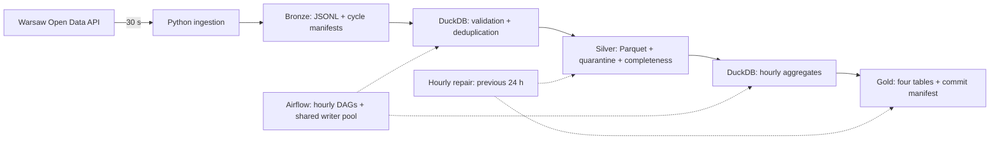

# Warsaw Transit Data Pipeline

**[English](README.md) · [Polski](README.pl.md)**

[](https://github.com/mati290/ZTM_data_proccesing/actions/workflows/ci.yml)

A data engineering portfolio project that turns Warsaw bus and tram GPS snapshots into validated, hourly analytics. It combines **Python, Airflow, DuckDB, MinIO and Parquet**, with explicit data-quality rules and recoverable publications.

**What it answers:** how many vehicle identifiers were observed per hour, which lines were represented, and whether collection and processing produced data suitable for analysis. It does not measure timetable punctuality or every vehicle actually in service.

**Status:** the pipeline and automated tests are implemented. A single-server Oracle ARM deployment has been prepared and tested; long-running operational acceptance, production hardening and a dashboard remain work in progress. There is no public dashboard or guaranteed-availability service.

**Start here:** [run a demo without an API key](#demo-without-a-ztm-api-key) · [collect live data](#collect-live-data) · [data contract](docs/gold-data-contract.en.md) · [limitations](#limitations-and-next-steps)

## A quick tour for reviewers

| Review area | Where to look | What to verify |
|---|---|---|
| API collection | [ingest.py](ingest.py), [ingestion_contract.py](ingestion_contract.py) | Retries, UTC polling slots, source-linked v2 manifests, safe error summaries |
| Data cleaning | [bronze_to_silver.py](bronze_to_silver.py) | Explicit JSON schema, GPS age/DST checks, quarantine, hourly deduplication |
| Analytics | [silver_to_gold.py](silver_to_gold.py) | Four Gold tables, key/schema checks, cross-table reconciliation |
| Recovery | [late_data.py](late_data.py), [dags/](dags/) | Input snapshots, missing artifacts, Gold-only repair and finalization |
| Verification | [tests/](tests/), [CI workflow](.github/workflows/ci.yml) | Unit tests, container tests and real MinIO recovery scenarios |

The engineering focus is **trustworthy results when collection is incomplete or a write fails**, rather than adding distributed tools before the workload needs them.

## Architecture



MinIO provides S3-compatible object storage. Airflow schedules transformations for completed UTC hours; all three writer tasks share a one-slot pool. The repair DAG runs at minute `30`, checks the previous 24 closed hours, and rebuilds only the required layers.

| Component | Version / role |
|---|---|
| Python | 3.12 in ingestion/CI; 3.13 in the Airflow image |
| Apache Airflow | 3.2.1; orchestration and retries |
| DuckDB | 1.2.2; SQL transformations and Parquet |
| MinIO / boto3 | S3-compatible storage and object operations |
| Docker Compose | Local and single-host execution |
| unittest / Ruff / GitHub Actions | Regression, integration and quality checks |

## Demo without a ZTM API key

This path uses **synthetic fixtures in a separate `ztm-demo` Docker project**. It never starts the real ingestion process or calls the ZTM API. No local Python installation is needed; Docker with the Compose plugin is required. The first build downloads images and dependencies, so it is not an offline demo.

1. Clone the repository and enter its root:

```sh
git clone https://github.com/mati290/ZTM_data_proccesing.git
cd ZTM_data_proccesing
```

2. In a **separate terminal**, set these demo-only values using the block for your shell. These public placeholders are not deployment credentials. Environment variables override `.env`; close this terminal before using a live environment.

```bash
# Bash / Linux / macOS
export ZTM_API_KEY=demo-not-used
export MINIO_USER=demo-user
export MINIO_PASSWORD=demo-password
export AIRFLOW__CORE__FERNET_KEY=MDAwMDAwMDAwMDAwMDAwMDAwMDAwMDAwMDAwMDAwMDA=
```

```powershell
# Windows PowerShell
$env:ZTM_API_KEY = "demo-not-used"
$env:MINIO_USER = "demo-user"
$env:MINIO_PASSWORD = "demo-password"
$env:AIRFLOW__CORE__FERNET_KEY = "MDAwMDAwMDAwMDAwMDAwMDAwMDAwMDAwMDAwMDAwMDA="
```

3. Run the demo from the repository root. The following commands work in Bash and PowerShell:

```sh
docker compose -p ztm-demo build ingestion airflow
docker compose -p ztm-demo up -d minio
docker compose -p ztm-demo run --rm -T --no-deps -v "${PWD}/tests:/tmp/ztm-tests:ro" airflow python -B /tmp/ztm-tests/smoke_e2e.py
docker compose -p ztm-demo run --rm -T --no-deps -v "${PWD}/tests:/tmp/ztm-tests:ro" airflow python -B /tmp/ztm-tests/pipeline_e2e.py
```

The scripts create fixtures, run Bronze → Silver → Gold, check results, and clean their test objects. Successful recovery checks finish with `PIPELINE E2E OK`. Scenarios cover incomplete/complete hours, copy and commit failures, retries, finalization, duplicate slots, lost inputs and all-rejected quarantine. See [smoke_e2e.py](tests/smoke_e2e.py) and [pipeline_e2e.py](tests/pipeline_e2e.py).

**Expected:** no business data remains in the demo after successful cleanup. This is an automated demonstration, not a populated dashboard. Port `9000`/`9001` must be free on your computer. Never point these scripts at real application storage.

Optional full test suite in the Airflow image, using the same demo terminal:

```sh
docker compose -p ztm-demo run --rm -T --no-deps -v "${PWD}/tests:/opt/airflow/src/tests:ro" -v "${PWD}/dags:/opt/airflow/src/dags:ro" -v "${PWD}/analysis:/opt/airflow/src/analysis:ro" -v "${PWD}/ingest.py:/opt/airflow/src/ingest.py:ro" -v "${PWD}/check_ingestion_health.py:/opt/airflow/src/check_ingestion_health.py:ro" -w /opt/airflow/src airflow python -B -m unittest discover -s tests -v
```

Remove only this disposable demo environment when finished:

```sh
docker compose -p ztm-demo down --volumes
```

`--volumes` deletes the demo volumes. Do not use it against an environment whose data you want to preserve. Interrupted smoke runs can leave a lock or fixtures; inspect them before retrying or removing a lock.

## Collect live data

Use a new terminal without the demo overrides. You need Docker Compose and your own key from [Warsaw Open Data](https://api.um.warszawa.pl).

1. Copy `.env.example` to `.env` (`cp .env.example .env` in Bash, `Copy-Item .env.example .env` in PowerShell). Fill in `ZTM_API_KEY`, `MINIO_USER` and `MINIO_PASSWORD` (at least eight characters). Keep the file private and out of Git.
2. Generate a Fernet key without installing Python locally:

```sh
docker run --rm --entrypoint python apache/airflow:3.2.1 -c "from cryptography.fernet import Fernet; print(Fernet.generate_key().decode())"
```

Put the generated value in `AIRFLOW__CORE__FERNET_KEY` in `.env`. This command only generates a key; it does not start the application. Docker may download the Airflow image on first use.

3. Keep `POLL_INTERVAL_SECONDS=30` for the baseline configuration, then start:

```sh
docker compose up -d --build
docker compose ps
```

Ingestion creates `bronze`, `silver` and `gold` automatically. Wait for Airflow to become healthy before running its CLI commands. On a reused metadata volume, pause the existing DAGs before upgrading; paused-at-creation only applies to new DAGs.

4. Create the required pool and enable the three DAGs:

```sh
docker compose exec -T airflow airflow pools set ztm_silver_gold_writer 1 "Serializes Silver and Gold writes"
docker compose exec -T airflow airflow dags unpause bronze_to_silver_hourly
docker compose exec -T airflow airflow dags unpause silver_to_gold_hourly
docker compose exec -T airflow airflow dags unpause reprocess_late_data_hourly
```

5. Inspect [Airflow](http://localhost:8080), [MinIO](http://localhost:9001) and `docker compose logs --tail=50 ingestion`. MinIO uses your `.env` credentials. With the local all-admin Airflow configuration, the UI is not a public authentication boundary. Do not publish raw standalone startup logs: they may contain generated login details.

**When results appear:** collection writes Bronze immediately. Hourly DAGs process the preceding closed UTC hour. An hour first becomes eligible for `is_final` 15 minutes after closing; the repair schedule normally finalizes it at minute `30`. Starting mid-hour can leave that first hour incomplete. A missing hour is a visible gap, not zero activity.

Stop with `docker compose down` to retain the data and metadata volumes. Manual rebuilds must respect the same single-writer rule as DAG tasks. The local Compose profile uses Airflow standalone/SQLite and is a development/test configuration.

## Data products and correctness

| Gold table | Grain | Example use |
|---|---|---|
| `hourly_network_metrics` | UTC collection hour | Observed vehicles, bus/tram split, position events |
| `hourly_line_metrics` | Hour × vehicle type × line | Compare observed line activity |
| `vehicle_activity_hourly` | Hour × vehicle type × vehicle number | Observation span, lines and coordinate bounds |
| `hourly_data_quality` | Hour | Slot coverage, rejections, finality and current safety policy |

Bronze is partitioned by the **UTC polling slot**, not GPS event time. Source GPS timestamps are interpreted in `Europe/Warsaw`; invalid, ambiguous and nonexistent local times are quarantined. Valid GPS age is 0–5 minutes, and deduplication uses `(vehicle_type, vehicle_number, gps_time_utc)` within one partition hour.

At 30-second polling, a closed hour expects 120 slots. `complete` requires at least 95% coverage and 90% complete slots among observed slots. Repeated manifests do not inflate unique-slot coverage. Manifest counts and slot counts remain separate metrics.

Publication entry points:

```text
silver/vehicle_positions/date=YYYY-MM-DD/hour=HH/_active.json
gold/_commits/date=YYYY-MM-DD/hour=HH/manifest.json
```

Each points to a prepared, versioned publication. Read a Gold commit **once** and use the exact table URIs together. Do not glob all `_versions` files: that would include superseded outputs. Missing/empty Silver diagnostics do not replace a full Gold commit. Legacy layouts remain supported with additional identity and consistency checks.

`safe_for_dashboard` is a **defined policy, not a completeness guarantee**. It requires sufficient evidence, complete status, nonempty Silver, finality and integrity rejections ≤5%. Duplicates and stale GPS are excluded from that integrity rate; a high stale-GPS share therefore needs separate interpretation. `is_final` does not close the correction window. See the [full data contract](docs/gold-data-contract.en.md).

## Tests and validation status

For local Python development:

```sh
python -m venv .venv
# Activate the environment for your shell, then:
python -m pip install -r requirements.txt
python -m pip install ruff==0.16.10
python -m ruff check .
python -m ruff format --check .
python -B -m unittest discover -s tests -v
```

On Windows you can use `.\.venv\Scripts\python.exe` instead of `python`. Local tests without Airflow intentionally skip the DAG tests; the container path above runs them too.

**Validation snapshot, 21 October 2026:** 322 tests passed inside Airflow on Linux ARM64 without skips; smoke and recovery integration scenarios also passed. Local tests passed with ten Airflow tests skipped. These are functional results, not a throughput benchmark or proof of 24/7 availability. CI builds the images, checks DAG discovery, runs the full suite inside Airflow and executes both MinIO integration scripts. See [CI runs](https://github.com/mati290/ZTM_data_proccesing/actions).

## Limitations and next steps

- **Operations:** external backups/restore, log/data retention, end-to-end Gold alerts and tested host recovery are not yet implemented. A Docker volume is not an off-host backup; `unhealthy` alone does not trigger a Compose restart.
- **Deployment:** the Oracle ARM setup is a controlled single-host test. Production acceptance requires PostgreSQL metadata, measured resource/time limits and repeatable deployment/rollback. Panels remain private; public authentication/TLS and a dashboard are future work.
- **Recovery:** default repair covers 24 hours, not arbitrary history. Changed or deleted previously used Bronze objects block rebuilding until restored. Keep raw objects immutable and retain the inputs required by corrections.
- **Semantics:** observed vehicles are not a fleet census. Do not sum hourly distinct counts into daily uniques. `active_seconds` is an observation span, not driving time. GPS observations can recur across adjacent collection partitions.
- **Compatibility:** S3 compatibility was tested with MinIO, not end to end on AWS S3. Cold connections install/load DuckDB `httpfs`; this remains a deployment dependency.

Next milestones: **first real collection → backup/monitoring → production profile and recovery → 24–48 h acceptance → committed-Gold reader → dashboard → public release**. No additional Kafka/Spark/Kubernetes infrastructure is required for the current scope.

## Source and attribution

Source data: Miasto Stołeczne Warszawa, [UM Warszawa Open Data API](https://api.um.warszawa.pl). GPS snapshots describe what the upstream feed reports; availability and coverage depend on that source. No API keys, server addresses or private deployment credentials are required to review this repository.
