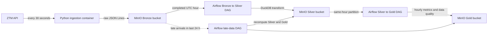

# 🚋 Warsaw Transit Data Platform

A data engineering project that continuously collects **real-time GPS positions
of all Warsaw public transport vehicles** (ZTM buses and trams) from the
[UM Warszawa Open Data API](https://api.um.warszawa.pl) and stores them in an
S3-compatible data lake. The implemented pipeline follows a **medallion
architecture**: raw JSON Lines in bronze and cleaned, hourly Parquet in silver;
hourly business and data-quality metrics in gold.

> 🚧 Work in progress – ingestion, hourly Bronze → Silver and Silver → Gold
> pipelines, late-data recomputation, tests, and GitHub Actions CI are implemented.
> A dashboard and production cloud deployment remain future work; see the
> [roadmap](#roadmap).

## Architecture



Locally the data lake runs on **MinIO**, which provides an S3-compatible API.
The pipeline has not yet been deployed or validated end to end on AWS S3.

## Tech stack

| Area | Technology |
|---|---|
| Language | Python 3.12 |
| Data source | UM Warszawa REST API |
| Object storage | MinIO (S3-compatible), boto3 |
| Orchestration | Apache Airflow 3 |
| Transformation | DuckDB |
| Containerization | Docker, Docker Compose |
| Data formats | JSON Lines (bronze), Parquet (silver), Hive-style partitioning |
| Testing and linting | unittest, Ruff |
| CI | GitHub Actions |

## How to run

### Prerequisites

- [Docker Desktop](https://www.docker.com/products/docker-desktop/)
- A free API key from [api.um.warszawa.pl](https://api.um.warszawa.pl) (register an account)

### Steps

1. Clone the repository:
   ```bash
   git clone https://github.com/mati290/ZTM_data_proccesing.git
   cd ZTM_data_proccesing
   ```

2. Create your `.env` file from the template and fill in the values:
   ```bash
   cp .env.example .env
   ```
   Keep your real API key and MinIO credentials in `.env`; never commit that file.

   If reusing an existing Airflow metadata volume, pause the three project DAGs
   before restarting the stack. The paused-at-creation setting below applies
   only to DAGs Airflow discovers for the first time.

3. Build and start the local stack:
   ```bash
   docker compose up -d --build
   ```

   Compose starts MinIO, the ingestion container, and Airflow. Ingestion creates
   the `bronze`, `silver`, and `gold` buckets if they do not exist. Newly
   discovered Airflow DAGs are paused by default so they cannot run before the
   required pool is configured.

4. Create the Airflow pool that serializes writes to Silver and Gold:
   ```bash
   docker compose exec airflow airflow pools set ztm_silver_gold_writer 1 "Serializes Silver and Gold writes"
   ```

5. Open the Airflow UI at http://localhost:8080 and unpause the
   `bronze_to_silver_hourly`, `silver_to_gold_hourly`, and
   `reprocess_late_data_hourly` DAGs. The first two share an hourly schedule:
   Bronze → Silver processes a completed UTC hour, then Silver → Gold waits
   for that hour's Silver task and builds the four Gold tables. The late-data
   DAG runs hourly at minute 30 and recomputes eligible closed hours from the
   last 24 hours. Gold fails on a schema mismatch or missing Silver; task
   retries and published row counts/status are visible in Airflow.

   An hour with no Bronze data *after* ingestion has started (an outage)
   **fails** the Silver run after retries so the gap remains visible; once
   Bronze data is available again, clear the failed run in the UI to reprocess
   it. Hours before the first Bronze object are skipped. Hourly catchup is
   disabled, so the DAGs do not automatically create runs for every missed
   interval since their `start_date`; existing historical runs are not deleted.
   MinIO's console is at http://localhost:9001.

6. Check ingestion logs:
   ```bash
   docker compose logs -f ingestion
   ```

To stop the services, run `docker compose down`. Bronze, Silver, and Gold
objects are kept in the `minio_data` Docker volume.

## Data layout (bronze layer)

```
s3://bronze/
└── vehicle_type=bus/
    └── date=2026-10-02/
        └── hour=08/
            └── positions_20261002T083205_<uuid>.jsonl
└── vehicle_type=tram/
    └── ...
```

Each line is one vehicle position, stored exactly as returned by the API,
plus an `_ingested_at` metadata field:

```json
{"Lines": "180", "Lon": 21.01, "VehicleNumber": "1234", "Time": "2026-10-02 10:32:01", "Lat": 52.23, "Brigade": "3", "_ingested_at": "2026-10-02T08:32:05+00:00"}
```

The Silver layer contains one Parquet file per processed hour:

```text
s3://silver/vehicle_positions/date=2026-10-02/hour=08/data.parquet
```

Rejected records are written with a `rejection_reason` column under
`s3://silver/quarantine/vehicle_positions/date=.../hour=.../data.parquet`.
The raw Bronze objects remain unchanged and can be used to rebuild both outputs.

## Design decisions

- **Raw data in bronze is never modified.** Only an `_ingested_at` field is
  added (the underscore marks fields added by the pipeline, not the source).
  If a bug is found in later transformations, silver can always be rebuilt
  from the original data.
- **Ingestion timestamps and partitions are in UTC.** The API's `Time` field
  is Warsaw local time without an explicit UTC offset. During the repeated hour
  at the autumn DST transition, the source value alone cannot identify which
  occurrence it means; the pipeline's time filter and quarantine preserve that
  limitation instead of claiming perfect UTC reconstruction.
- **Hive-style partitioning** (`key=value` folders by vehicle type, date and
  hour) allows query engines like Spark, Athena or DuckDB to skip irrelevant
  data (partition pruning).
- **JSON Lines format** – one record per line, so files can be processed
  line by line and in parallel without loading everything into memory.
- **Validating API responses.** The API returns HTTP 200 even on errors and
  puts an error message in `result` instead of a list. The pipeline detects
  this and fails loudly instead of silently saving empty or invalid files.
- **Retry with exponential backoff** (2 s, 4 s) for transient network and API
  errors. A single failed cycle is logged and doesn't stop the long-running
  process.
- **Failures stay visible.** An empty Bronze partition is detected by listing
  matching S3 objects. Storage/listing errors propagate and fail the Airflow
  task instead of being reported as an empty hour. Records whose GPS `Time`
  is more than 5 minutes older than `_ingested_at` (or later than it) are
  rejected to quarantine; whole-hour completeness is tracked via ingestion
  manifests and a `_completeness.json` marker.
- **Secrets are kept out of logs.** Request errors are summarized by exception
  type and HTTP status, without logging a request URL that may contain the API
  key.
- **Empty batches are skipped** to avoid creating empty files.
- **Configuration via environment variables** (12-factor app). Secrets live
  in `.env`, which is excluded from Git and from the Docker image
  (`.dockerignore`).
- **Image versioning.** Airflow uses an explicit image version. The free
  Chainguard MinIO channel supplies `latest`; use a tested image digest before
  deploying outside local development.
- **Docker layer caching:** dependencies are installed before the code is
- Nowe dane Bronze i manifest cyklu są przypisywane do partycji godziny UTC,
  w której rozpoczyna się slot cyklu pobierania. Cykl przekraczający granicę
  godziny lub północ zachowuje tę samą partycję dla autobusów, tramwajów
  i manifestu. Pole `_ingested_at` nadal zawiera rzeczywisty czas zapisu
  danych. Godzina partycji nie oznacza godziny zdarzenia GPS i może różnić
  się od godziny `_ingested_at`. Historyczne obiekty zapisane według czasu
  zapisu pozostają w dotychczasowych partycjach.

## Known limitations

- Polling every 30 seconds produces thousands of small JSONL objects in
  Bronze. The hourly Silver output compacts transformed records into Parquet,
  but raw Bronze objects are not compacted or expired yet.
- The local Airflow metadata database is now persisted in a Docker volume so
  task history and DAG metadata survive container restarts. MinIO object data
  remains in its own named volume as well.
- Silver is partitioned by ingestion hour and deduplicated per hour only
  (`vehicle_type`, `vehicle_number`, `gps_time_utc`, latest `_ingested_at`
  wins). If the same GPS fix is ingested just before and just after an hour
  boundary, it can appear in two consecutive Silver files. This is deliberate:
  widening the window would change every quality/rejection query and break
  per-hour count reconciliation. Gold is also built per Silver hour; therefore
  a fix present in two adjacent Silver partitions can contribute to both hourly
  results. Do not interpret the sum of hourly position counts as a globally
  deduplicated event count.
- Completeness: every ingestion cycle writes a manifest to
  `s3://bronze/_manifests/date=/hour=/` (`complete` only if both bus and tram
  were fetched). The Silver transform writes
  `vehicle_positions/date=/hour=/_completeness.json` with status `complete`
  (≥90% of cycles complete), `incomplete`, or `unknown` (no manifests, e.g.
  data from before this feature). Silver is still published for incomplete
  hours. Gold preserves metrics for incomplete and unknown hours but marks
  their quality; dashboard consumers should use
  `hourly_data_quality.safe_for_dashboard = TRUE` as the default filter and
  visibly flag excluded hours. A missing completeness marker is treated as
  `unknown`, not complete.
- Late data: closed hours of the last 24 h are recomputed by the
  `reprocess_late_data_hourly` DAG (`late_data.py`) when Bronze objects are
  newer than the Silver partition, which also repairs gaps. Each Silver or Gold
  output object is replaced atomically and reruns are idempotent; the four Gold
  objects are not a single cross-table transaction, and the quality table is
  published last. Older hours are frozen. Gold rows carry `pipeline_run_at`,
  `source_max_ingested_at` and `is_final` (an hour is final 15 min after it
  closes); `safe_for_dashboard` requires `is_final`. See
  `docs/gold-data-contract.md`.
- A successful API response with an empty result is logged and counted as a
  degraded source window. Alerts are currently log-based; no external alert
  destination is configured.
- This is a local portfolio environment, not a production deployment. AWS S3
  and cloud infrastructure are not yet configured.

## Roadmap

- [x] **Stage 1** – ZTM API ingestion to MinIO Bronze, Dockerized
- [x] **Stage 2** – hourly Airflow and DuckDB transformation from Bronze to
      partitioned Silver Parquet, with missing-Bronze detection (outage gaps
      fail the run), per-record GPS freshness validation, quality metrics,
      quarantine output, and deterministic deduplication
- [x] **Stage 3 foundation** – unit tests, Ruff linting/format checks, and
      GitHub Actions CI
- [x] **Gold stage 1** – [Gold data contract](docs/gold-data-contract.md)
      defines grains, keys, metric definitions, publication conditions, and
      incomplete/missing-data behavior
- [x] **Gold stages 2–4** – `silver_to_gold.py` builds four Gold tables
      (per-object atomic publish, schema validation, idempotent) and runs as a
      DAG task after Silver
- [x] **Gold stage 5** – Airflow Silver → Gold DAG waits for the same-hour Silver
      task; shared writer pool serializes partition writes
- [x] **Gold stage 6** – late-data policy recomputes eligible closed hours from
      the last 24 hours, with finality and source-ingestion metadata in Gold
- [ ] **Next** – Gold dashboard with an expected-hour gap axis; consider dbt
      when the models justify it
- [ ] **Next** – add volume thresholds, external alerting, and integration
      coverage for a more reliable deployment
- [ ] **Could** – deploy to AWS S3 and provision infrastructure with Terraform
- [ ] **Could** – expand dashboard options (for example, Metabase) after the
      first Gold dashboard is in place
- [ ] Kafka and Spark are intentionally deferred until a streaming-scale use
      case justifies their operational cost.

## Data source

Data provided by Miasto Stołeczne Warszawa via
[api.um.warszawa.pl](https://api.um.warszawa.pl).
