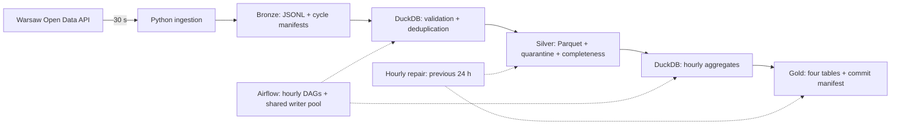

# Pipeline danych transportu publicznego w Warszawie

**[Polski](README.pl.md) · [English](README.md)**

[](https://github.com/mati290/ZTM_data_proccesing/actions/workflows/ci.yml)

Projekt portfolio z inżynierii danych: przekształca migawki pozycji GPS warszawskich autobusów i tramwajów w zweryfikowane agregaty godzinowe. Łączy **Python, Airflow, DuckDB, MinIO i Parquet** z jawnymi regułami jakości oraz mechanizmem odzyskiwania publikacji.

**Na jakie pytania odpowiada:** ile identyfikatorów pojazdów zaobserwowano w godzinie, jakie linie pojawiły się w danych i czy pobieranie oraz przetwarzanie dostarczyły materiał do analizy. Nie mierzy punktualności względem rozkładu ani wszystkich pojazdów faktycznie kursujących.

**Stan:** pipeline i testy automatyczne są zaimplementowane. Wdrożenie na pojedynczym serwerze działa obecnie w Google Cloud w Warszawie, po wcześniejszym teście Oracle ARM. Rzeczywiste dane dotarły do Silver i Gold, ale błędy połączenia z zewnętrznym API przerwały zbieranie; odbiór pełnej godziny i długiego działania pozostaje otwarty. Zabezpieczenia produkcyjne i dashboard są w toku. Projekt nie udostępnia jeszcze publicznego dashboardu ani usługi z gwarancją dostępności.

**Szybki start:** [demo bez klucza API](#demo-bez-klucza-api-ztm) · [zbieranie prawdziwych danych](#zbieranie-prawdziwych-danych) · [kontrakt danych](docs/gold-data-contract.md) · [ograniczenia](#ograniczenia-i-kolejne-kroki)

## Projekt w kilka minut

| Obszar przeglądu | Pliki | Co sprawdzić |
|---|---|---|
| Pobieranie API | [ingest.py](ingest.py), [ingestion_contract.py](ingestion_contract.py) | Ponawianie, sloty UTC, manifesty v2 powiązane ze źródłami, bezpieczne logi błędów |
| Czyszczenie | [bronze_to_silver.py](bronze_to_silver.py) | Jawny schemat JSON, wiek GPS i DST, kwarantanna, deduplikacja godzinowa |
| Analityka | [silver_to_gold.py](silver_to_gold.py) | Cztery tabele Gold, schematy, klucze i uzgadnianie agregacji |
| Odzyskiwanie | [late_data.py](late_data.py), [dags/](dags/) | Snapshoty wejścia, brakujące pliki, naprawa samego Gold i finalizacja |
| Weryfikacja | [tests/](tests/), [workflow CI](.github/workflows/ci.yml) | Testy jednostkowe, kontenerowe i scenariusze awarii z prawdziwym MinIO |

Główny cel inżynierski to **wiarygodny wynik mimo braków pobierania lub przerwanego zapisu**, bez rozbudowy infrastruktury ponad potrzeby projektu.

## Architektura



MinIO zapewnia storage zgodny z API S3. Airflow przetwarza zakończone godziny UTC; trzy zadania zapisujące współdzielą pulę z jednym slotem. DAG korekt uruchamia się w minucie `30`, sprawdza poprzednie 24 zamknięte godziny i odbudowuje tylko wymagane warstwy.

| Komponent | Wersja / zastosowanie |
|---|---|
| Python | 3.12 w ingestion/CI; 3.13 w obrazie Airflow |
| Apache Airflow | 3.2.1; orkiestracja i ponawianie zadań |
| DuckDB | 1.2.2; transformacje SQL i Parquet |
| MinIO / boto3 | Storage zgodny z S3 i operacje na obiektach |
| Docker Compose | Uruchomienie lokalne i na jednym hoście |
| unittest / Ruff / GitHub Actions | Testy regresji, integracji i kontrola jakości |

## Demo bez klucza API ZTM

Ta ścieżka używa **danych syntetycznych w oddzielnym projekcie Docker `ztm-demo`**. Nie uruchamia właściwej ingestii i nie odpytuje API ZTM. Wystarczy Docker z pluginem Compose; lokalny Python nie jest potrzebny. Pierwszy build pobiera obrazy i zależności, więc demo wymaga internetu.

1. Sklonuj repozytorium i przejdź do jego katalogu:

```sh
git clone https://github.com/mati290/ZTM_data_proccesing.git
cd ZTM_data_proccesing
```

2. W **oddzielnym terminalu** ustaw wartości demonstracyjne, wybierając blok dla swojej powłoki. To publiczne przykłady, nie hasła wdrożenia. Zmienne środowiskowe mają pierwszeństwo przed `.env`; zamknij ten terminal przed pracą z właściwym środowiskiem.

```bash
# Bash / Linux / macOS
export ZTM_API_KEY=demo-not-used
export MINIO_USER=demo-user
export MINIO_PASSWORD=demo-password
export AIRFLOW__CORE__FERNET_KEY=MDAwMDAwMDAwMDAwMDAwMDAwMDAwMDAwMDAwMDAwMDA=
```

```powershell
# Windows PowerShell
$env:ZTM_API_KEY = "demo-not-used"
$env:MINIO_USER = "demo-user"
$env:MINIO_PASSWORD = "demo-password"
$env:AIRFLOW__CORE__FERNET_KEY = "MDAwMDAwMDAwMDAwMDAwMDAwMDAwMDAwMDAwMDAwMDA="
```

3. Uruchom demo z katalogu głównego repozytorium. Poniższe polecenia działają w Bash i PowerShell:

```sh
docker compose -p ztm-demo build ingestion airflow
docker compose -p ztm-demo up -d minio
docker compose -p ztm-demo run --rm -T --no-deps -v "${PWD}/tests:/tmp/ztm-tests:ro" airflow python -B /tmp/ztm-tests/smoke_e2e.py
docker compose -p ztm-demo run --rm -T --no-deps -v "${PWD}/tests:/tmp/ztm-tests:ro" airflow python -B /tmp/ztm-tests/pipeline_e2e.py
```

Skrypty przygotowują dane, uruchamiają Bronze → Silver → Gold, sprawdzają wyniki i usuwają swoje obiekty testowe. Poprawne zakończenie scenariuszy odzyskiwania zawiera `PIPELINE E2E OK`. Sprawdzane są godziny incomplete/complete, błędy kopiowania i commitu, retry, finalizacja, powtórzone sloty, utrata wejścia i kwarantanna wszystkich odrzuconych wierszy. Implementacja: [smoke_e2e.py](tests/smoke_e2e.py), [pipeline_e2e.py](tests/pipeline_e2e.py).

**Oczekiwany wynik:** po udanym sprzątaniu dane biznesowe demo nie pozostają w storage. To demonstracja automatyczna, nie dashboard wypełniony przykładowymi danymi. Lokalne porty `9000`/`9001` muszą być wolne. Nie uruchamiaj tych skryptów na właściwym magazynie danych aplikacji.

Opcjonalnie uruchom cały zestaw testów w obrazie Airflow, w tym samym terminalu demo:

```sh
docker compose -p ztm-demo run --rm -T --no-deps -v "${PWD}/tests:/opt/airflow/src/tests:ro" -v "${PWD}/dags:/opt/airflow/src/dags:ro" -v "${PWD}/analysis:/opt/airflow/src/analysis:ro" -v "${PWD}/ingest.py:/opt/airflow/src/ingest.py:ro" -v "${PWD}/check_ingestion_health.py:/opt/airflow/src/check_ingestion_health.py:ro" -w /opt/airflow/src airflow python -B -m unittest discover -s tests -v
```

Po zakończeniu usuń wyłącznie jednorazowe środowisko demonstracyjne:

```sh
docker compose -p ztm-demo down --volumes
```

`--volumes` usuwa wolumeny demo. Nie używaj go wobec środowiska, którego dane mają pozostać. Przerwany smoke może zostawić blokadę lub dane testowe; obejrzyj je przed ponowieniem albo ręcznym usunięciem blokady.

## Zbieranie prawdziwych danych

Użyj nowego terminala, bez zmiennych demo. Potrzebujesz Docker Compose i własnego klucza z [API Warszawy](https://api.um.warszawa.pl).

1. Skopiuj `.env.example` do `.env` (`cp .env.example .env` w Bash, `Copy-Item .env.example .env` w PowerShell). Uzupełnij `ZTM_API_KEY`, `MINIO_USER`, `MINIO_PASSWORD` (minimum osiem znaków). Plik przechowuj prywatnie, poza Gitem.
2. Wygeneruj klucz Fernet bez lokalnej instalacji Pythona:

```sh
docker run --rm --entrypoint python apache/airflow:3.2.1 -c "from cryptography.fernet import Fernet; print(Fernet.generate_key().decode())"
```

Wklej wygenerowaną wartość do `AIRFLOW__CORE__FERNET_KEY` w `.env`. Polecenie tylko generuje klucz i nie uruchamia aplikacji. Docker może przy pierwszym użyciu pobrać obraz Airflow.

3. Pozostaw `POLL_INTERVAL_SECONDS=30` jako konfigurację bazową i uruchom:

```sh
docker compose up -d --build
docker compose ps
```

Ingestion automatycznie tworzy `bronze`, `silver` i `gold`. Przed poleceniami CLI Airflow poczekaj na status healthy. Przy aktualizacji istniejącego wolumenu metadanych najpierw wstrzymaj DAG-i: ustawienie paused-at-creation dotyczy wyłącznie nowych definicji.

4. Utwórz wymaganą pulę i włącz trzy DAG-i:

```sh
docker compose exec -T airflow airflow pools set ztm_silver_gold_writer 1 "Serializes Silver and Gold writes"
docker compose exec -T airflow airflow dags unpause bronze_to_silver_hourly
docker compose exec -T airflow airflow dags unpause silver_to_gold_hourly
docker compose exec -T airflow airflow dags unpause reprocess_late_data_hourly
```

5. Sprawdź [Airflow](http://localhost:8080), [MinIO](http://localhost:9001) i `docker compose logs --tail=50 ingestion`. MinIO używa danych z `.env`. Lokalny tryb all-admin Airflow nie zapewnia granicy uwierzytelniania dla publicznego dostępu. Nie publikuj surowych logów startowych standalone: mogą zawierać wygenerowane dane logowania.

**Kiedy pojawią się wyniki:** Bronze powstaje od początku zbierania. DAG-i godzinowe przetwarzają poprzednią zamkniętą godzinę UTC. `is_final` jest możliwe po 15 minutach od końca godziny; harmonogram korekt zwykle finalizuje ją w minucie `30`. Start w środku godziny może dać pierwszą godzinę incomplete. Brak danych to luka, nie zerowa aktywność.

`docker compose down` zatrzymuje usługi, zachowując wolumeny danych i metadanych. Ręczne przebudowy muszą przestrzegać tej samej zasady pojedynczego writera co DAG-i. Lokalny profil Compose korzysta ze standalone/SQLite i służy do rozwoju oraz testów.

## Produkty danych i poprawność

| Tabela Gold | Ziarno | Zastosowanie |
|---|---|---|
| `hourly_network_metrics` | Godzina UTC pobierania | Zaobserwowane pojazdy, podział bus/tram, liczba obserwacji |
| `hourly_line_metrics` | Godzina × typ pojazdu × linia | Porównanie obserwowanej aktywności linii |
| `vehicle_activity_hourly` | Godzina × typ pojazdu × numer | Rozstęp obserwacji, linie i zakres współrzędnych |
| `hourly_data_quality` | Godzina | Pokrycie slotów, odrzucenia, finalizacja i bieżąca polityka bezpieczeństwa |

Bronze jest partycjonowane według **slotu UTC pobierania**, nie czasu zdarzenia GPS. Czas źródłowy jest interpretowany w `Europe/Warsaw`; wartości błędne, niejednoznaczne i nieistniejące przy zmianie czasu trafiają do kwarantanny. Dopuszczalny wiek GPS to 0–5 minut, a klucz deduplikacji w obrębie godziny to `(vehicle_type, vehicle_number, gps_time_utc)`.

Przy interwale 30 s pełna godzina ma 120 oczekiwanych slotów. `complete` wymaga minimum 95% pokrycia i 90% kompletnych slotów spośród obecnych. Powtórzone manifesty nie zwiększają pokrycia unikalnych slotów. Liczniki manifestów i slotów pozostają osobnymi metrykami.

Punkty wejścia publikacji:

```text
silver/vehicle_positions/date=YYYY-MM-DD/hour=HH/_active.json
gold/_commits/date=YYYY-MM-DD/hour=HH/manifest.json
```

Każdy wskazuje przygotowaną wersję danych. Manifest Gold czytaj **raz**, używając wspólnie dokładnych URI tabel. Nie czytaj globem wszystkich plików `_versions`: obejmują też wersje zastąpione. Diagnostyka brakującego/pustego Silver nie zastępuje pełnego commitu Gold. Historyczne układy są obsługiwane z dodatkowymi kontrolami tożsamości i spójności.

`safe_for_dashboard` to **zdefiniowana polityka, nie gwarancja pełności danych**. Wymaga dostatecznych dowodów kompletności, statusu complete, niepustego Silver, finalizacji i odrzuceń integralności ≤5%. Duplikaty oraz stare GPS są wyłączone z tego ostatniego wskaźnika; wysoki udział starego GPS wymaga osobnej interpretacji. `is_final` nie zamyka okna korekt. Szczegóły: [kontrakt danych](docs/gold-data-contract.md).

## Testy i stan weryfikacji

Lokalny development w Pythonie:

```sh
python -m venv .venv
# Aktywuj środowisko odpowiednio do powłoki, następnie:
python -m pip install -r requirements.txt
python -m pip install ruff==0.16.10
python -m ruff check .
python -m ruff format --check .
python -B -m unittest discover -s tests -v
```

W Windows zamiast `python` można wskazać `.\.venv\Scripts\python.exe`. Bez lokalnego Airflow testy DAG-ów są celowo pomijane; podana wcześniej ścieżka kontenerowa uruchamia również je.

**Stan weryfikacji z 21 października 2026:** 322 testy przeszły w Airflow na Linux ARM64 bez pominięć; przeszły również smoke i integracyjne scenariusze odzyskiwania. Lokalnie testy przeszły z dziesięcioma pominięciami Airflow. To weryfikacja funkcjonalna, nie benchmark ani dowód dostępności 24/7. CI buduje obrazy, sprawdza wykrywanie DAG-ów, uruchamia cały zestaw w Airflow i oba skrypty integracyjne MinIO. [Przebiegi CI](https://github.com/mati290/ZTM_data_proccesing/actions).

## Ograniczenia i kolejne kroki

Compose ogranicza logi stdout/stderr każdego kontenera do 3 plików po 10 MB (około 90 MB łącznie dla trzech usług). Zmiana wymaga odtworzenia kontenerów; zwykły restart nie wystarczy. Osobne pliki logów zadań w wolumenie Airflow nie są objęte tym limitem i nadal wymagają retencji.

- **Utrzymanie:** automatyczne kopie poza serwerem z próbą restore, retencja plików logów Airflow i danych, alarmy końcowego Gold i test odzyskania hosta pozostają otwarte. Istnieje zweryfikowane jednorazowe archiwum migracyjne; nie zastępuje ono cyklicznych backupów. Wolumen Dockera nie jest backupem poza VM; samo unhealthy nie uruchamia restartu Compose. Przy błędach źródeł kolektor wydłuża przerwy do 60/120/240/300 sekund, respektuje HTTP 429 Retry-After i nie ponawia trwałych błędów 4xx wewnątrz pojedynczego pobrania.
- **Wdrożenie:** Google Cloud w Warszawie to kontrolowany test jednego hosta finansowany czasowym kredytem próbnym. Odbiór produkcyjny wymaga PostgreSQL, limitów zasobów/czasu dobranych po pomiarach oraz odtwarzalnego deployu/rollbacku. Panele są prywatne; publiczny dostęp/TLS i dashboard pozostają przed nami.
- **Naprawy:** domyślne okno to 24 h, nie cała historia. Zmienione lub usunięte wcześniej użyte wejście Bronze blokuje przebudowę do czasu odtworzenia. Obiekty surowe pozostają niezmienne; retencja musi zachować wejścia do korekt.
- **Znaczenie metryk:** zaobserwowane pojazdy to nie pełna flota. Nie sumuj godzinowych distinctów jako unikalnych pojazdów dnia. `active_seconds` nie oznacza czasu jazdy. Ten sam GPS może wystąpić w sąsiednich partycjach pobierania.
- **Zgodność:** testowano MinIO, nie pełną integrację AWS S3. Zimne połączenia instalują/ładują DuckDB `httpfs`; to nadal zależność wdrożeniowa.

Kolejne kamienie milowe: **pierwsze dane → backup/monitoring → profil produkcyjny i odzyskiwanie → odbiór 24–48 h → czytnik commitów Gold → dashboard → publiczne wydanie**. Obecny zakres nie wymaga Kafka, Spark ani Kubernetesa.

## Źródło i autorstwo danych

Dane: Miasto Stołeczne Warszawa, [UM Warszawa Open Data API](https://api.um.warszawa.pl). Migawki GPS opisują to, co raportuje źródło; dostępność i pokrycie zależą od zewnętrznego API. Do przeglądu repozytorium nie są potrzebne klucze API, adresy serwera ani prywatne dane wdrożenia.
